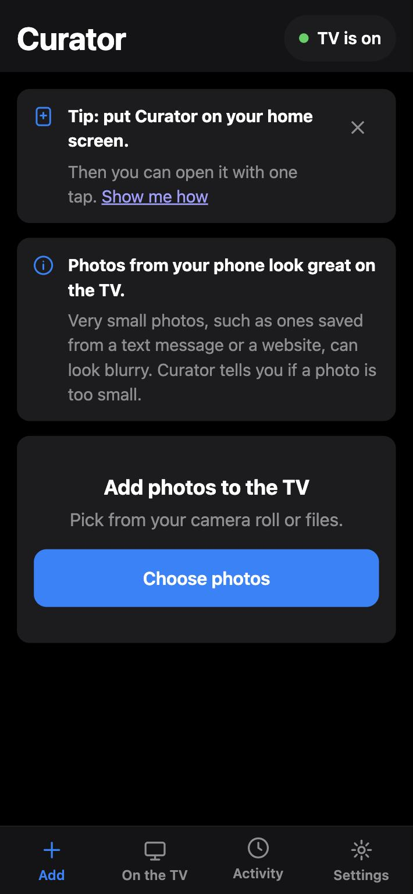
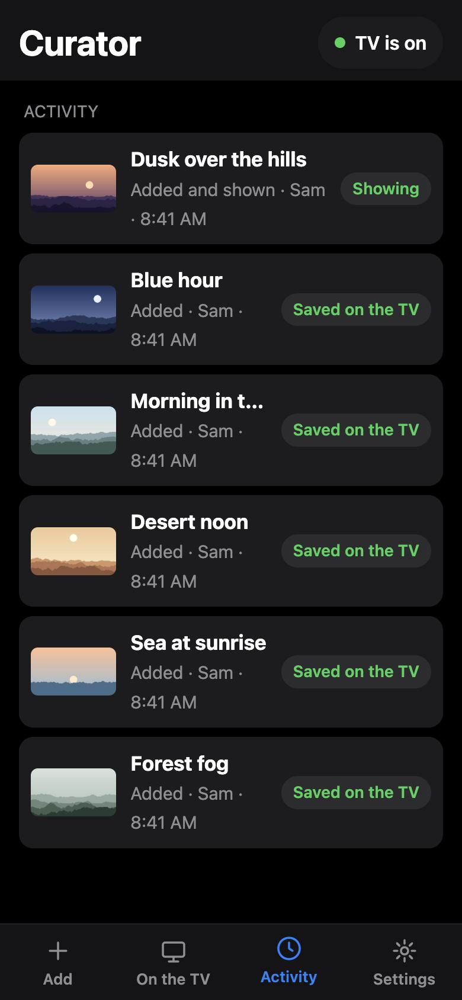

# Curator

Curator shows your own photos in the Art Mode of a Samsung The Frame TV, using a Raspberry Pi on your home network.

<p align="center">



</p>

## What it does

- Send photos from any phone or computer browser on your home network.
- See what is on the TV now, and switch to another photo.
- Check an activity list that shows who chose each photo and when.
- Keep photos in a queue while the TV is off. When the TV answers, Curator sends them.
- No subscription, no cloud, and no account. Your photos never leave your network.

## What you need

- A Samsung The Frame TV on your home network. Curator was tested on a 2021 Frame (Tizen 6).
- A Raspberry Pi on the same network. A Pi 4 or newer is suggested. It must run Raspberry Pi OS with Python 3.11 or newer.

## Install

On the Pi, run these commands:

```bash
sudo apt install -y git python3-venv
```

```bash
sudo git clone https://github.com/tommcfarlin/curator.git /opt/curator
```

```bash
sudo chown -R "$(id -un):$(id -gn)" /opt/curator
```

```bash
/opt/curator/deploy/install.sh
```

The first time, `install.sh` asks two questions. First, choose your TV from the list. Second, accept the address that Curator listens on.

For the full guide, including pairing with the TV, see [docs/DEPLOY.md](docs/DEPLOY.md).

## Set it up with an AI agent

You can give [docs/AGENT-SETUP.md](docs/AGENT-SETUP.md) to an AI coding agent, such as Claude Code. The agent must run on the Pi or have SSH access to it. The agent then walks through the install with you.

## Try it without a TV

You can run Curator on your computer with a pretend TV. You do not need a TV or a Pi for this.

```bash
python3 -m venv .venv
```

```bash
.venv/bin/pip install -r requirements-dev.txt
```

```bash
.venv/bin/python -m curator --fake-tv --port 8087
```

Open `http://127.0.0.1:8087` in a browser. In the page, tap the status pill at the top to switch the pretend TV on or off.

To open the page from your phone, add `--bind 0.0.0.0` to the last command. Then use your computer's address on your Wi-Fi. Press Control-C to stop the server.

## Good to know

- Curator cannot turn the TV on. When the screen is black, the TV leaves the network. Turn the TV on with the remote. If the TV is off, photos wait in the queue. Curator sends them as soon as the TV answers.
- Turn off Night Mode in the TV's Art Mode options. If Night Mode is on, the TV turns the screen off in a dark room, and Curator cannot reach it.
- Reserve fixed addresses for the TV and the Pi on your router. Curator can find a TV that changes address, but a fixed address is more reliable.
- The web page has no login. Keep Curator on your home network.

## Warning

This project uses an unofficial interface to the TV. Samsung does not document it. A TV software update can break it without notice. If uploads stop after an update, update the `samsungtvws` library first.

## Run the tests

The tests do not need a TV or a Pi.

```bash
python3 -m venv .venv
```

```bash
.venv/bin/pip install -r requirements-dev.txt
```

```bash
.venv/bin/python -m pytest
```

## License

Curator is released under the MIT License. See the [LICENSE](LICENSE) file.

Curator uses the `samsungtvws` library, which is under the LGPL-3.0 license. See [docs/HOW-IT-WORKS.md](docs/HOW-IT-WORKS.md) for how Curator works and the licenses of its dependencies.
